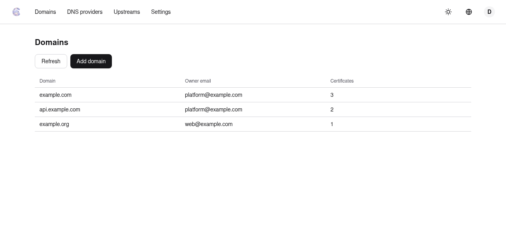

<p align="center">
  
</p>
<h3 align="center">CertCenter</h3>
<p align="center">A self-hosted certificate service for ACME issuance, renewal and deployment across managed domains.</p>

<p align="center">
  <a href="README.md">English</a> · <a href="README_zh.md">简体中文</a>
</p>

<p align="center">
  <a href="docs/guide.md">Documentation</a> · <a href="#quick-start">Deployment</a> · <a href="docs/guide.md#bootstrap-configuration">Environment variables</a>
</p>

<p align="center">
  <a href="https://github.com/OXeu/certcenter/actions/workflows/ci.yml"></a>
  <a href="go.mod"></a>
  <a href="package.json"></a>
  <a href="LICENSE"></a>
</p>

## Preview



Domain management in the actual web UI, rendered with synthetic example data.

## Features

- Domain ownership, certificate policies and ACME DNS validation.
- Issuance, renewal and upstream deployment with persistent jobs and event history.
- Encrypted certificate material and provider credentials.
- Local persistent configuration or ConfigCenter, SQLite/MySQL and a bilingual Vue UI.

## Quick Start

Install Git, Make, Node.js 24.15+ with npm, and Go 1.26.10, with Git access to the pinned center-common repository. A fresh checkout can start in local configuration mode without a remote ConfigCenter.

```sh
git clone https://github.com/OXeu/certcenter.git
cd certcenter
make bootstrap
make build
./.tmp/bin/certcenter
```

Open http://127.0.0.1:8081. The defaults create `.tmp/certcenter.db` and `.tmp/certcenter-config.json`, including a generated encryption key. Preserve the configuration store when retaining application data.

### Enable certificate management

The minimal local instance serves the login page without an OAuth provider. Configure OAuth and the administrator identity before signing in, then configure ACME, DNS providers and deployment targets. The [setup guide](docs/guide.md) explains the ConfigCenter-backed configuration path and the `certcenter.server` / `certcenter.providers` keys.

### Production and development

Use an HTTPS public address, persistent configuration and a production database. Runtime settings are stored configuration, not arbitrary `CC_*` environment overrides. See [bootstrap configuration](docs/guide.md#bootstrap-configuration) and run `make check` with golangci-lint installed before deployment.

## Star History

[](https://www.star-history.com/#OXeu/certcenter&Date)

## LICENSE

Licensed under the [Apache License 2.0](LICENSE).
