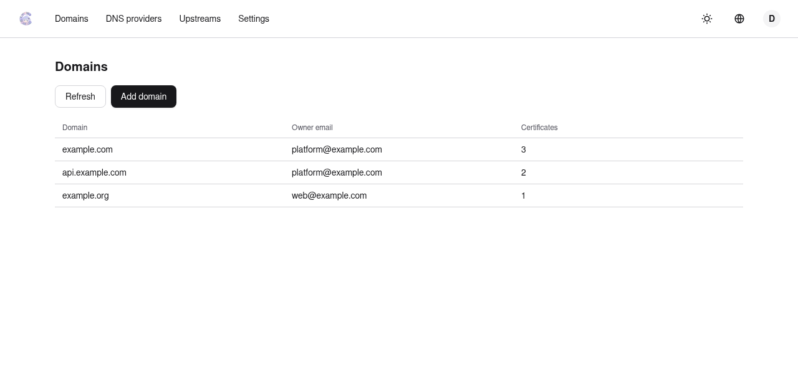

<p align="center">
  
</p>
<h3 align="center">CertCenter</h3>
<p align="center">面向域名管理、ACME 签发、续期与部署的自托管证书服务。</p>

<p align="center">
  <a href="README.md">English</a> · <a href="README_zh.md">简体中文</a>
</p>

<p align="center">
  <a href="docs/guide_zh.md">使用文档</a> · <a href="#快速开始">部署</a> · <a href="docs/guide_zh.md#引导配置">环境变量</a>
</p>

<p align="center">
  <a href="https://github.com/OXeu/certcenter/actions/workflows/ci.yml"></a>
  <a href="go.mod"></a>
  <a href="package.json"></a>
  <a href="LICENSE"></a>
</p>

## 预览



域名管理界面，使用实际前端与示例数据渲染。

## 功能

- 域名归属、证书策略与 ACME DNS 验证。
- 签发、续期和上游部署，保留任务状态与事件记录。
- 加密保存证书材料和提供商凭据。
- 本地持久配置或 ConfigCenter、SQLite / MySQL 与双语 Vue 界面。

## 快速开始

需要 Git、Make、带 npm 的 Node.js 24.15+、Go 1.26.10，以及锁定的 center-common 仓库的读取权限。全新检出可直接使用本地配置模式，无需远程 ConfigCenter。

```sh
git clone https://github.com/OXeu/certcenter.git
cd certcenter
make bootstrap
make build
./.tmp/bin/certcenter
```

打开 http://127.0.0.1:8081。默认创建 `.tmp/certcenter.db` 和 `.tmp/certcenter-config.json`，并生成加密密钥。保留应用数据时也必须持久保存配置存储。

### 启用证书管理

最小本地实例可提供登录页，尚未配置 OAuth 身份提供商。登录前需配置 OAuth 和管理员身份，再设置 ACME、DNS 提供商和部署目标。[配置指南](docs/guide_zh.md)说明了 ConfigCenter 接入方式和 `certcenter.server` / `certcenter.providers` 两个配置键。

### 生产部署与开发

生产环境使用 HTTPS 公网地址、持久配置和生产数据库。运行参数来自配置存储，而不是任意 `CC_*` 环境变量；[引导配置](docs/guide_zh.md#引导配置)列出可用变量。发布前安装 golangci-lint 并运行 `make check`。

## Star History

[](https://www.star-history.com/#OXeu/certcenter&Date)

## LICENSE

本项目采用 [Apache License 2.0](LICENSE) 开源协议。
